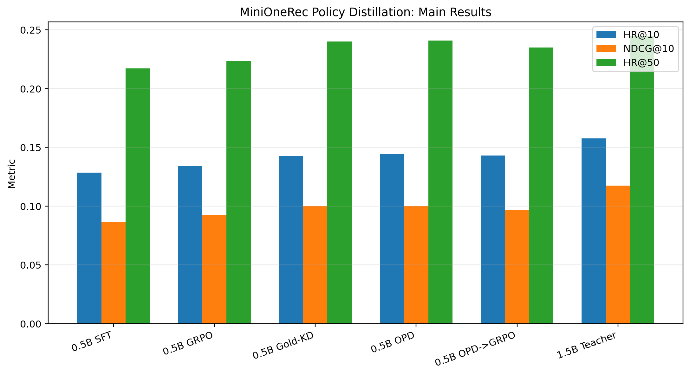
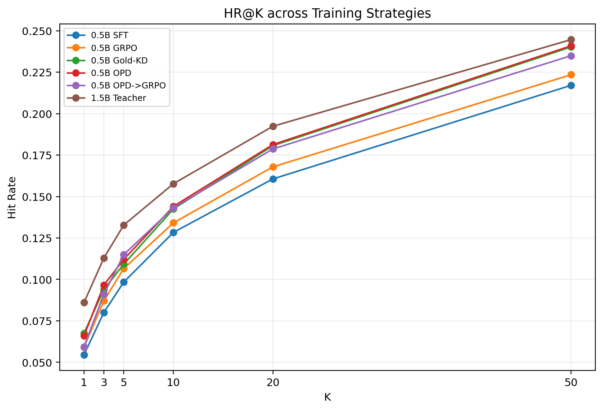
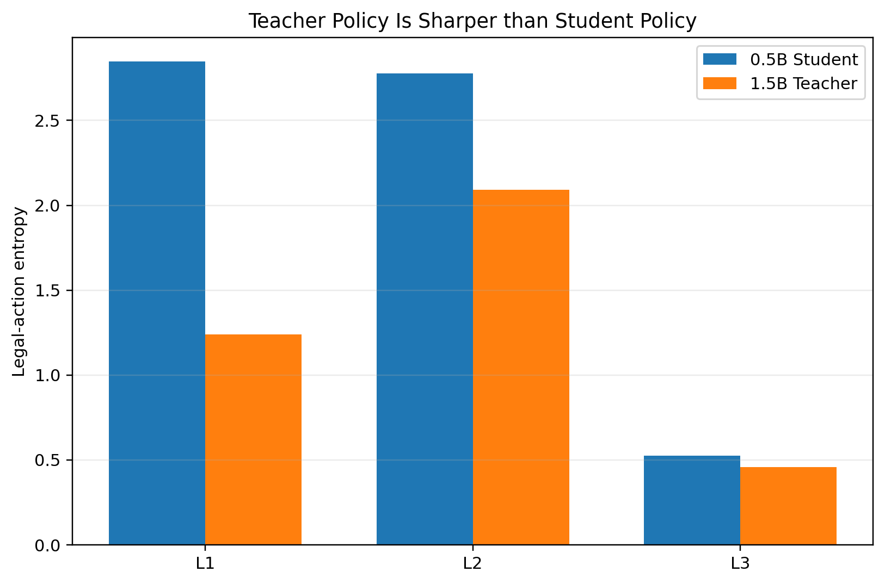

# MiniOneRec-PolicyDistill

**Constrained Policy Distillation for Hierarchical Generative Recommendation**

This project reproduces the 0.5B MiniOneRec SFT/GRPO pipeline and extends it with constrained policy distillation from a stronger 1.5B generative recommender.

The core idea is:

> Instead of relying only on sparse sequence-level GRPO rewards, transfer the teacher's full recommendation policy over the legal Semantic ID (SID) action space.

## Highlights

Best 0.5B result on the Amazon **Industrial & Scientific** test set:

- **HR@10: 0.1441**
- **NDCG@10: 0.1002**
- **HR@50: 0.2409**

Reproduced 0.5B GRPO baseline:

- HR@10: 0.1341
- NDCG@10: 0.0924
- HR@50: 0.2235

The distilled 0.5B student reaches **HR@50 = 0.2409**, close to the 1.5B teacher's **0.2447**.

This repository is built upon the open-source [MiniOneRec](https://github.com/AkaliKong/MiniOneRec) implementation.

---

## 1. Motivation

MiniOneRec formulates recommendation as autoregressive generation of hierarchical Semantic IDs.

An item is represented by a multi-level SID such as:

```text
[SID-1] -> [SID-2] -> [SID-3]
```

Generation is constrained by a catalogue trie so that generated SID sequences correspond to valid items.

We first reproduced the original MiniOneRec pipeline:

```text
0.5B SFT
   |
   v
0.5B GRPO
```

The reproduced GRPO model improves recommendation quality:

| Model | HR@10 | NDCG@10 | HR@50 |
|---|---:|---:|---:|
| 0.5B SFT | 0.1284 | 0.0863 | 0.2171 |
| 0.5B SFT -> GRPO | 0.1341 | 0.0924 | 0.2235 |

However, inspection of the GRPO training process revealed an important limitation:

- reward is defined at the generated-item / sequence level;
- exact target hits are sparse;
- many completion groups contain no exact target item;
- therefore many groups provide limited exact recommendation supervision.

At the same time, the official 1.5B MiniOneRec checkpoint is substantially stronger:

| Model | HR@10 | NDCG@10 | HR@50 |
|---|---:|---:|---:|
| 1.5B Teacher | 0.1577 | 0.1175 | 0.2447 |

This motivates the main question:

> Can a smaller generative recommender directly learn the stronger teacher's recommendation policy instead of relying only on sparse sequence-level rewards?

---

## 2. Constrained Policy Distillation

At a decoding state \(s\), the catalogue SID trie defines the legal next-action set

\[
\mathcal{A}(s).
\]

Instead of distilling over the full LLM vocabulary, both teacher and student distributions are restricted to the legal SID action set.

The training objective is the exact legal-action reverse KL:

\[
D_{\mathrm{KL}}
\left(
\pi_S^{\mathcal A}(\cdot \mid s)
\;\|\;
\pi_T^{\mathcal A}(\cdot \mid s)
\right).
\]

This provides dense distributional supervision at every SID decision.

For the Industrial & Scientific catalogue used in our experiments:

- SID depth: 3
- root legal actions: 48
- average L2 legal actions: about 57
- average L3 legal actions: about 4.4

The legal recommendation action space is therefore dramatically smaller than the full tokenizer vocabulary, making exact policy distillation practical.

---

## 3. Gold-Prefix KD vs. On-Policy Distillation

We evaluate two state distributions while keeping the teacher, student, KL objective, optimizer, and training data fixed.

### Gold-Prefix KD

Training follows the ground-truth SID prefix:

\[
s_t = (x, y^*_{<t}).
\]

Example:

```text
Ground-truth SID: [A] [B] [C]

states:
x
x + [A]
x + [A] [B]
```

The gold SID is used only to select the next state. It is not added as an extra CE loss or reward.

### On-Policy Distillation

The student generates its own SID trajectory:

\[
s_t = (x, y^S_{<t}).
\]

Example:

```text
Student trajectory: [X] [Y] [Z]

states:
x
x + [X]
x + [X] [Y]
```

The teacher supervises the student at states actually visited by the student.

Both variants share the same implementation:

```text
--state_mode gold
--state_mode on_policy
```

---

## 4. Main Results

All models are evaluated on the full Amazon **Industrial & Scientific** test split:

- 4,533 test examples
- constrained beam search
- beam size = 50

| Method | HR@10 | NDCG@10 | HR@50 |
|---|---:|---:|---:|
| 0.5B SFT | 0.1284 | 0.0863 | 0.2171 |
| 0.5B SFT -> GRPO | 0.1341 | 0.0924 | 0.2235 |
| 0.5B SFT -> Gold-KD | 0.1425 | 0.0998 | 0.2402 |
| **0.5B SFT -> OPD** | **0.1441** | **0.1002** | **0.2409** |
| 0.5B OPD -> GRPO | 0.1432 | 0.0968 | 0.2349 |
| 1.5B Teacher | 0.1577 | 0.1175 | 0.2447 |



Compared with the 0.5B SFT model:

```text
HR@10:    0.1284 -> 0.1441
NDCG@10:  0.0863 -> 0.1002
HR@50:    0.2171 -> 0.2409
```

Compared with the reproduced GRPO baseline:

```text
HR@10:    0.1341 -> 0.1441
NDCG@10:  0.0924 -> 0.1002
HR@50:    0.2235 -> 0.2409
```

The 0.5B OPD student recovers approximately **86% of the original teacher-student HR@50 gap**.

---

## 5. HR@K Comparison



The complete numerical results are available in:

```text
results/main_results.csv
```

---

## 6. What Does the Teacher Actually Know?

A stronger final recommender is not necessarily a stronger greedy next-token classifier.

Under ground-truth SID prefixes:

| SID Level | Student Top-1 | Teacher Top-1 | Student Entropy | Teacher Entropy |
|---|---:|---:|---:|---:|
| L1 | 0.278 | 0.262 | 2.847 | 1.238 |
| L2 | 0.224 | 0.202 | 2.778 | 2.092 |
| L3 | 0.654 | 0.644 | 0.524 | 0.458 |

The teacher has slightly lower local Top-1 accuracy in this diagnostic despite substantially stronger final HR/NDCG.

It also produces a much sharper policy, especially at the early SID levels:



This suggests that the teacher's advantage is better described as **better constrained sequence-level ranking** rather than uniformly stronger greedy token prediction.

This motivates transferring the complete legal-action distribution rather than only using teacher argmax pseudo-labels.

---

## 7. KD vs. OPD

Gold-prefix KD and OPD both substantially outperform SFT and GRPO:

| Method | HR@10 | NDCG@10 | HR@50 |
|---|---:|---:|---:|
| Gold-KD | 0.1425 | 0.0998 | 0.2402 |
| OPD | 0.1441 | 0.1002 | 0.2409 |

The difference between the two variants is small.

The strongest conclusion supported by the experiments is therefore:

> Most of the improvement comes from transferring the stronger teacher's constrained SID policy distribution.

On-policy states provide a small additional improvement at several ranking cutoffs, but the current single-seed comparison is not sufficient to claim a statistically significant advantage over gold-prefix KD.

---

## 8. Why Not Apply GRPO After OPD?

We also tested:

```text
SFT -> OPD -> GRPO
```

The result is worse than OPD alone:

| Method | HR@10 | NDCG@10 | HR@50 |
|---|---:|---:|---:|
| OPD | 0.1441 | 0.1002 | 0.2409 |
| OPD -> GRPO | 0.1432 | 0.0968 | 0.2349 |

In particular:

```text
NDCG@10: 0.1002 -> 0.0968
HR@50:   0.2409 -> 0.2349
```

This negative result suggests that subsequent sparse sequence-level RL optimization can partially distort the dense teacher policy transferred during distillation.

We therefore keep this experiment as an ablation instead of stacking GRPO into the final method.

---

## 9. Training Data

The policy-distillation training mixture follows the MiniOneRec RL data construction:

| Dataset | Number of Prompts |
|---|---:|
| SidDataset | 36,259 |
| RLTitle2SidDataset | 6,516 |
| RLSeqTitle2SidDataset | 10,000 |
| **Total** | **52,775** |

With batch size 32:

```text
52775 / 32 ~= 1649 full optimizer steps
```

Main distillation settings:

```text
max_steps = 1649
batch_size = 32
learning_rate = 1e-5
distill_temperature = 1.0
seed = 42
```

---

## 10. Repository Structure

```text
MiniOneRec-PolicyDistill/
|
├── src/
│   ├── policy_distill.py
│   ├── data.py
│   ├── grpo_train.py
│   ├── minionerec_trainer.py
│   ├── evaluate.py
│   └── calc.py
├── scripts/
│   ├── train_sft.sh
│   ├── train_grpo.sh
│   ├── train_kd.sh
│   ├── train_opd.sh
│   ├── evaluate.sh
│   └── make_figures.py
├── configs/
│   └── zero2_opt.yaml
├── diagnostics/
├── results/
│   ├── main_results.csv
│   ├── teacher_student_diagnostics.csv
│   └── README.md
├── assets/
│   ├── main_results.png
│   ├── hr_curve.png
│   └── policy_entropy.png
├── docs/
│   ├── EXPERIMENTS.md
│   └── INTERVIEW_NOTES.md
├── requirements.txt
├── NOTICE.md
├── LICENSE
└── README.md
```

The main policy-distillation implementation is:

```text
src/policy_distill.py
```


---

## 11. Environment

Experiments were run with:

```text
Python        3.11
PyTorch       2.6.0 + CUDA 12.4
Transformers  4.57.1
Datasets      4.2.0
Accelerate    1.10.1
TRL           0.24.0
DeepSpeed     0.18.0
```

Main hardware:

```text
2 x NVIDIA A100 40GB
```

Install dependencies with:

```bash
pip install -r requirements.txt
```

---

## 12. Training

Prepare the Amazon data following the original MiniOneRec repository.

Set the student, teacher, and data paths:

```bash
export STUDENT_MODEL=/path/to/0.5B-sft-checkpoint
export TEACHER_MODEL=/path/to/1.5B-teacher-checkpoint
export DATA_ROOT=/path/to/data/Amazon
```

### Gold-Prefix KD

```bash
bash scripts/train_kd.sh
```

Equivalent state mode:

```text
--state_mode gold
```

### On-Policy Distillation

```bash
bash scripts/train_opd.sh
```

Equivalent state mode:

```text
--state_mode on_policy
```

Both methods use the same policy-distillation implementation.

---

## 13. Core Training Logic

Conceptually:

```python
for prompt in batch:
    prefix = []

    for level in range(num_sid_levels):
        legal_actions = trie.allowed(prefix)

        student_logits = student(prompt, prefix)[legal_actions]
        teacher_logits = teacher(prompt, prefix)[legal_actions]

        loss += reverse_kl(student_logits, teacher_logits)

        if state_mode == "on_policy":
            next_token = sample(student_logits)
        else:
            next_token = gold_sid[level]

        prefix.append(next_token)
```

---

## 14. Main Takeaways

### Dense teacher policy supervision is effective

Both Gold-KD and OPD substantially outperform the reproduced GRPO baseline.

### On-policy states are not the main source of improvement

OPD performs slightly better than Gold-KD, but the difference is much smaller than the overall gain from policy distillation.

### Sparse RL does not necessarily compose with distillation

Applying GRPO after OPD reduces NDCG@10 and HR@50, showing that individually useful training stages do not necessarily compose monotonically.

---

## 15. Limitations

This repository is intended as a reproducible engineering and interview project rather than a claim of a new research method.

Current limitations include:

- experiments currently focus on Amazon Industrial & Scientific;
- KD vs. OPD comparisons use one training seed;
- the small OPD-over-KD difference is not claimed to be statistically significant;
- performance depends on access to a sufficiently strong teacher;
- the teacher policy is substantially sharper and may transfer over-confident behavior;
- no claim is made that policy distillation universally dominates GRPO.

---

## 16. Acknowledgement

This project builds upon:

**MiniOneRec: Scaling Generative Recommendation**

Original repository:

https://github.com/AkaliKong/MiniOneRec

MiniOneRec is released under the Apache License 2.0.

Files derived from the upstream implementation retain their original copyright and license notices.

See `LICENSE` and `NOTICE.md` for details.
